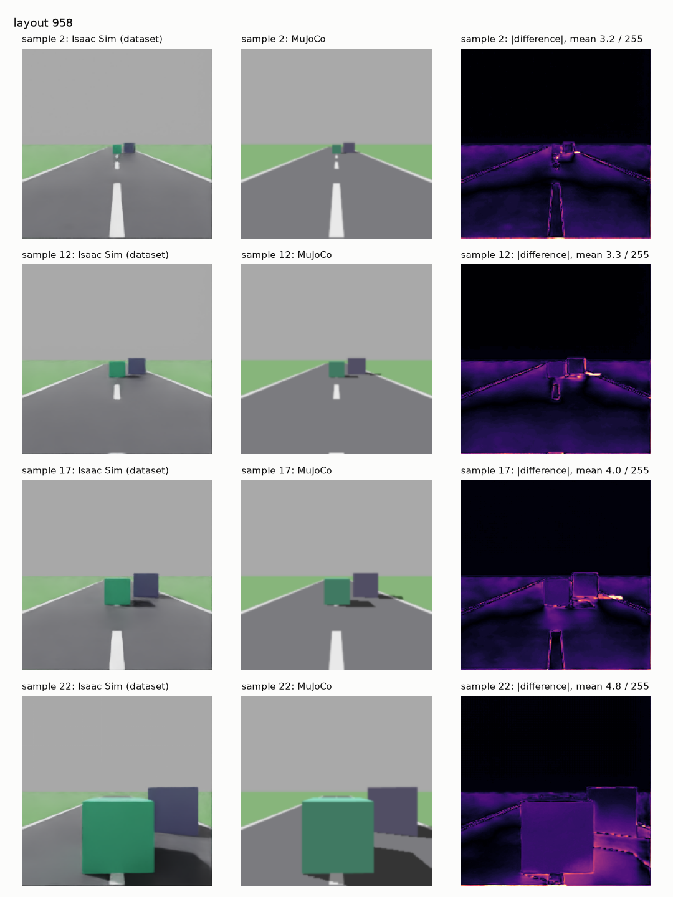

# MuJoCo renderer (trial, `mujoco_scene.py`)

A second renderer for the same scene, so closed-loop tests and data generation
could run without Isaac Sim, e.g. on a laptop without an NVIDIA GPU (Q19). Only
a renderer: the robot is a teleported point mass in both, so no physics is
needed. Trial of 2026-11-19 on layout 958, then checked on 20 more layouts.

```bash
.venv/bin/pip install mujoco                                       # 4.0.1 used
python3 compare_renderers.py data/grid --layouts 958 --figure compare.png
```

```python
import random
from sim_core.layout import sample_layout
from mujoco_scene import MujocoScene
sc = MujocoScene(sample_layout(random.Random(958)))   # layout 958 of the dataset (seed 958)
img = sc.render(x, y)                                  # uint8 [224, 224, 3], robot body centre at (x, y)
```

## Same layouts without Isaac Sim (`sim_core/layout.py`)

`sample_layout(random.Random(seed))` repeats the random draws of
`isaac_scene.place_obstacles` in pure Python: number, shape, size, position,
yaw **and colour** of the obstacles. It reproduces all 1000 layouts of
`data/grid` exactly (`tests/test_layout.py`). `isaac_scene.py` itself is
unchanged; if its draws change, the test fails. This is also the engine-free
layout sampling that planned sampling needs
([0008](../proposals/0008-expert-planned-sampling.md#what-it-needs)).

## How the scene is matched

| Item | Isaac Sim | MuJoCo |
|---|---|---|
| Road, lines, grass | boxes in `build_world` | same boxes and base colours |
| Obstacles | scaled USD cube / cylinder / sphere | box / cylinder / sphere geoms, same size, pose, colour |
| Camera | OAK-D `rgb_camera`, 0.275 m ahead of the body centre, 0.757 m high, 69° | same, level (horizon measured at row 113 of 224) |
| Sun | DistantLight 1200, rotate (−40, 20, 0) | directional light, same direction (−0.26, −0.64, −0.72), shadows |
| Dome light 300 | soft light from the whole sky | ambient light, 15 % of the sunlit level (measured on shaded cube faces) |
| Image | RTX: linear light → exposure / tone mapping → sRGB | linear render, then the tone curve fitted on Isaac's road surfaces |

The tone curve: `out = srgb(k·L / (1 + k·L / w))`, k = 1.91, w = 1.48
(L = 1: base colour in full sun), fitted on asphalt, grass and paint (max error
4 / 255). The sky is drawn unlit with the colour that comes out as Isaac's grey.
MuJoCo also gets 8× multisampling and a Gaussian blur of σ = 0.7 px for the
softness of Isaac's denoised image.

Pitfall: MuJoCo's `znear`, `zfar` and `shadowclip` are fractions of the model
extent. With the 200 m grass, `znear = 0.01` cut away everything closer than
~1.4 m. Fixed by setting `<statistic extent="100">` and `znear = 0.0002`
(2 cm). The directional light's position sets where its shadow box sits.

## Result



`compare_renderers.py` on the 25 grid samples per layout:

| | layout 958 | layouts 900–919 (20, all shapes) |
|---|---|---|
| Mean pixel difference | 3.5 / 255 (max 4.8) | 3.6 / 255 |
| Road markings overlap (IoU) | 0.90 | 0.89 |
| Obstacle overlap (IoU, rough colour segmentation of the Isaac image) | 0.62 | 0.64 |
| MuJoCo time per image (AMD Radeon 680M, EGL) | ~10 ms | ~10 ms |

- **Geometry matches**: horizon, road edges, dashed line, obstacle sizes and
  positions, shadow direction. The paint IoU of ~0.9 is limited by the soft
  edges in Isaac's image.
- **Colours** of sky, grass, asphalt and paint match within ~3 %. Obstacle faces
  within 3–27 % per channel (the shaded side of a coloured face is a little greyer in
  MuJoCo).
- **Remaining differences**: Isaac's soft contact shadows around obstacles (the
  dome light is blocked near them, ray-traced ambient occlusion) and soft
  shadow edges; MuJoCo shadows are harder. The obstacle IoU is limited by the
  colour segmentation of the Isaac image in these shadows, not by the geometry.
- **Speed**: ~10 ms per image vs ~0.25 s per sample in Isaac (incl. lidar),
  and it runs on an AMD laptop GPU and in Colab.

## Closed-loop test in MuJoCo (`drive_mujoco.py`, 2026-11-19)

```bash
python3 drive_mujoco.py --model runs/resnet18_001/model.ts --policy net expert forward --count 100
python3 drive_mujoco.py --model runs/resnet18_001/model.ts --count 100 --filter-alpha 0.7
```

**Watching it:** `--view` opens MuJoCo's viewer. The view follows the robot (orange box,
geom group 3, not in the camera images) and draws the driven path (green, red at the end of a
failed run). `--delay 0.05` slows it down. Closing the window stops the run. In the viewer's
left panel, camera `cam` is the robot's own view, in raw colours without the tone curve.
A static scene: `MUJOCO_GL=glfw python -m mujoco.viewer --mjcf=scene.xml` with
`build_xml(...)` written to a file.

```bash
python3 drive_mujoco.py --model runs/resnet18_001/model.ts --count 3 --view --delay 0.05
```

Same options and output files as `drive.py` (`episodes.jsonl`, `eval.json`, `--save-frames`
for `dagger.py`). The renderer-independent part (policies, episode loop, goal, scoring)
is in `closed_loop.py`, a copy of `drive.py`'s logic. Same layouts as an Isaac run with the
same seeds. CPU PyTorch in `.venv` is enough. The network takes ~22 ms per image on the
laptop CPU, the render ~10 ms, and 100 episodes take 2–6 minutes.

**ResNet18 trained on Isaac images (`resnet18_001`), 100 unseen layouts (100000–100099),
start x = −17 m, y = 0, steps of 0.2 m:**

| Motion | Policy | success | collision | off-road | timeout (stuck) |
|---|---|---|---|---|---|
| discrete steps | network | **83** | 0 | 0 | 17 |
| discrete steps | expert (fixed, see below) | 100 | 0 | 0 | 0 |
| discrete steps | always forward | 24 | 76 | 0 | 0 |
| side steps with 0.1 m forward | network | **97** | 3 | 0 | 0 |
| low-pass filter α = 0.7 | network | **80** | 2 | 18 | 0 |

Summaries: `docs/results/mujoco_drive_2026-11-19/`.

**After DAgger round 1, with a control** (same 100 evaluation layouts):

- `resnet18_dagger_r1`: grid + 20,015 MuJoCo frames from the network's own runs (layouts
  200000+), labelled by the expert.
- `resnet18_mjgrid` (control A): grid + 20,000 MuJoCo renders of the grid's own train
  positions. Same size, same Isaac / MuJoCo mix and same training steps as DAgger. The only
  difference is *where* the extra images were taken.

| Motion | Model | success | stuck | collision | off-road |
|---|---|---|---|---|---|
| discrete steps | baseline `resnet18_001` | 83 | 17 | 0 | 0 |
| | control A | 90 | 9 | 1 | 0 |
| | **DAgger r1** | **98** | **0** | **0** | 2 |
| side steps + 0.1 m forward | baseline | 97 | 0 | 3 | 0 |
| | control A | 96 | 0 | 4 | 0 |
| | **DAgger r1** | **98** | 0 | **0** | 2 |
| low-pass filter α = 0.7 | baseline | 80 | 0 | 2 | 18 |
| | control A | 90 | 0 | 3 | 7 |
| | **DAgger r1** | **91** | 0 | **0** | 9 |
| **all 300 episodes** | baseline | 260 | 17 | 5 | 18 |
| | control A | 276 | 9 | 8 | 7 |
| | **DAgger r1** | **287** | **0** | **0** | 13 |

Summaries: `docs/results/mujoco_drive_dagger_r1/`, `docs/results/mujoco_drive_mjgrid/`.

- **DAgger effect** (DAgger vs control A, equal data size and mix): it removes all stuck runs
  (9 → 0) and **all collisions** (8 → 0). The collisions happen beside an obstacle while
  passing it, and the grid has no such positions, so re-rendering it doesn't help (A even
  collides slightly more than the baseline).
- **Baseline → control A (+16 successes, not attributed):** A had twice the training images,
  the grid in two renderers (a kind of visual randomization) and twice the training steps.
  Together they fix about half of the stuck runs and most of the filter's off-road failures
  (18 → 7). Which factor matters is open. The most useful check is evaluating A and DAgger in
  Isaac (if A is better there too, it is generalization, not adaptation to MuJoCo images).
- **Remaining weakness of DAgger:** it leaves the road more often than A (13 vs 7). It dodges
  more decisively and sometimes overshoots the shoulder edge (|y| = 3.0 m). The grid has no
  samples between |y| = 2.0 and 2.9 m, and the expert has no asphalt preference (Q15).
- **Per-image scores don't predict driving:** on the Isaac grid test set DAgger is the
  weakest of the three (bal_acc 0.943 vs 0.959 baseline, 0.956 control), but it drives best.

**Same pattern as in Isaac.** The 3 layouts of the first Isaac test (2026-11-12,
100000–100002) end the same way: network 2/3 (stuck in front of the obstacles in
100002), expert 3/3, always forward 1/3. The model is different (that test used
`runs/smoke`), so this is an indication, not a direct comparison. The meeting
observations (stuck switching L/R; with the filter no deadlock, but failures)
appear here as well.

Where the network fails ([figure](../figures/2026-11-19_mujoco_drive_failures.png)):

- **Stuck (discrete) and off-road (filter) are one problem.** 16 of 17 timeouts
  and 17 of 18 off-road ends are 1.5–6 m **before** the first obstacle, after a
  first sideways move to a lateral position like y ≈ −2.2. The 5 × 5 grid only has
  y = 0, ±1.49, ±2.98, so these in-between positions were never in the training
  data. With discrete steps the network then switches L/R in place. With the filter
  its repeated "R" adds up and the robot slides across the shoulder to the edge of
  the allowed strip. → DAgger, planned sampling (0007 A, 0008).
- **Collisions happen beside the obstacle while passing it** (all 5): the smooth
  variants dodge only ~0.8 m, then the obstacle leaves the camera's view and
  the robot cuts back in. → memory, side cameras (0007 C, F), the stronger
  repulsion (wider dodge, 0007 E).

**Expert fix.** In the first run the expert itself ended off-road in 4 of 100
layouts: it plans on a lattice with 0.198 m lateral spacing, but the test moves
0.2 m per side step, so after ~15 side steps the robot is 2 cm further out than
the expert thinks, past |y| = 2.976 m. `closed_loop.ExpertPolicy` now checks the
real move and takes the next-best possible one, giving 100/100. **`drive.py` (Isaac)
still has the old version**: its expert results are slightly pessimistic until it
uses `closed_loop.py`.

Not done: lidar (could use MuJoCo ray casts or the analytic scan,
[0003](../proposals/0003-lidar-verification.md)), the robot body (not visible
from the camera), USD obstacle models, and a check how a network trained on
Isaac images drives in MuJoCo (sim-to-sim transfer).
