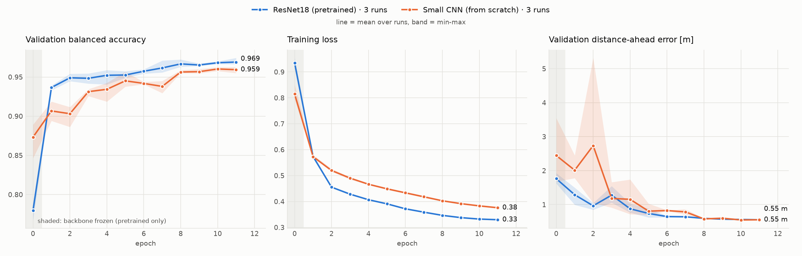
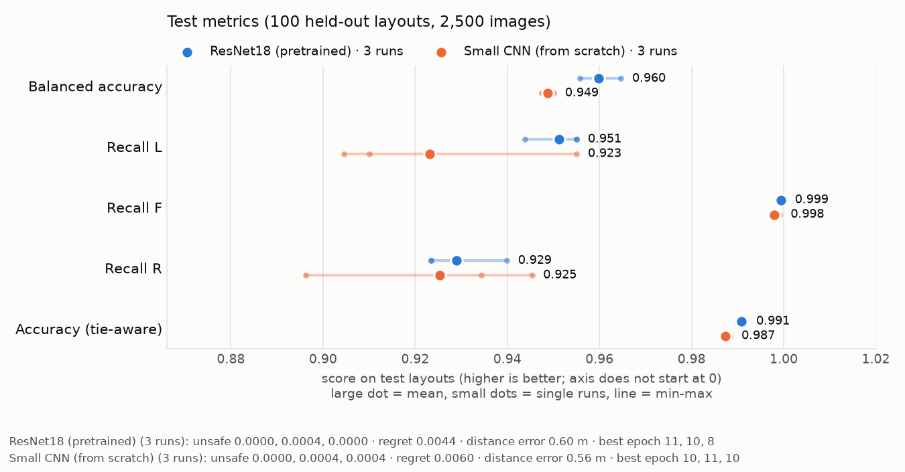
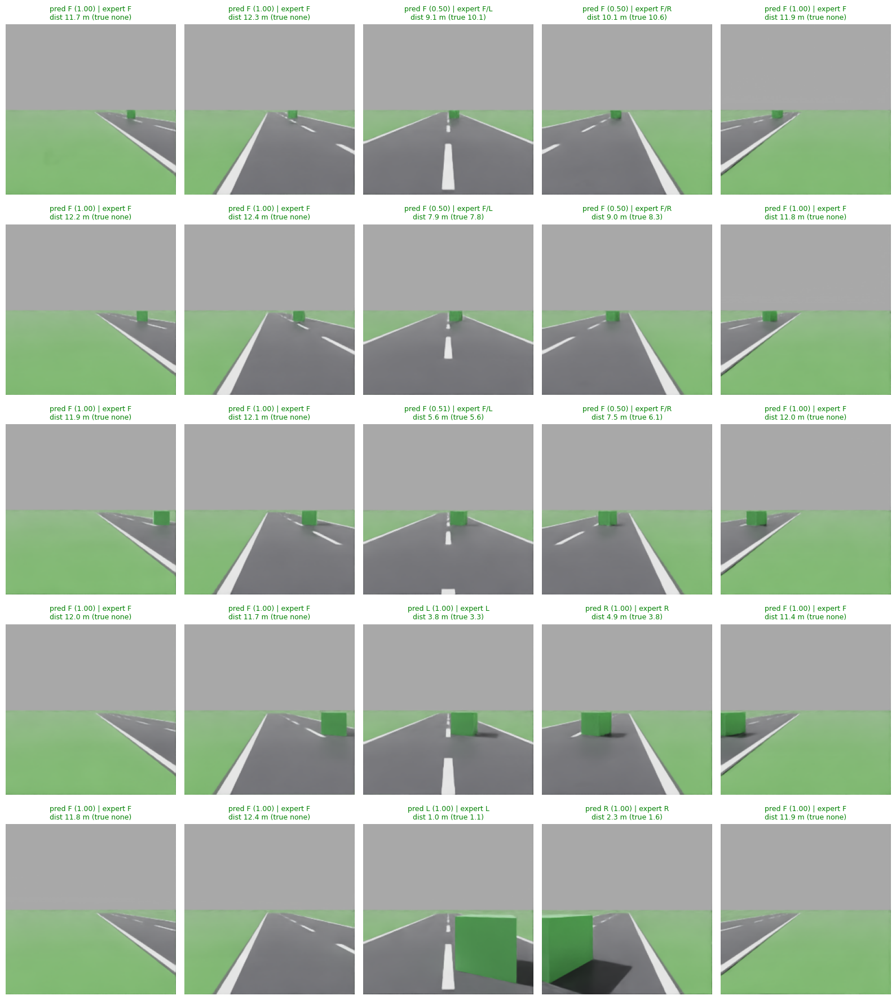

# Labelling and training (`label.py`, `train.py`, `training/`)

Image → decision (L / F / R) network, trained on the grid dataset
([scene-generator](scene-generator.md)) with labels from the cost-to-go
expert ([expert](expert.md)). Needs torch, torchvision, numpy and Pillow
(`requirements-train.txt`), not Isaac Sim.

```bash
.venv/bin/python label.py data/grid                                         # ~5 s, writes data/grid/labels.jsonl
.venv/bin/python train.py --data data/grid --model resnet18 --out runs/resnet18_001
.venv/bin/python train.py --data data/grid --model smallcnn --out runs/smallcnn_001   # baseline
```

Locally, torch (2.15, CUDA 13.2) is installed only in the project venv `.venv`,
so run the scripts with `.venv/bin/python`.

## Labels (`label.py`)

`labels.jsonl` has one line per sample: the expert action, the tied actions, the
four expert costs, the split and the distance targets. `labels_meta.json`
stores the expert settings and the class counts. Both live next to the data.

On the first dataset (1000 layouts, 25,000 samples, default costs and 5 m
lookahead):

| Split | Layouts | F | L | R | B |
|---|---|---|---|---|---|
| train | 0–799 | 86.0 % | 6.9 % | 7.1 % | 0 |
| val | 800–899 | 86.2 % | 7.2 % | 6.5 % | 0 |
| test | 900–999 | 85.6 % | 7.1 % | 7.3 % | 0 |

B never occurs, so the network has 3 classes (L, F, R). 8,315 samples (33 %)
have ties, mostly F = L or F = R in the far rows, and L = R with an obstacle
dead ahead.

## Model (`training/models.py`)

`DecisionNet` = backbone → 512-d (ResNet18) features → two heads:

- **action**: Linear → ReLU → Dropout 0.3 → Linear(3), logits over L, F, R
- **aux**: log of the free distance ahead (`dist_ahead`, clipped to 0.1–12 m),
  so the features have to encode distance, which the dodge decision depends on

The model normalises with the ImageNet mean / std itself. Input is RGB float in
[0, 1], `[N, 3, 224, 224]`. The TorchScript export `model.ts` therefore needs no
other preprocessing.

Backbones: `resnet18` (main), `mobilenet_v3_small`, `efficientnet_b0`
(ImageNet-pretrained) and `smallcnn` (5 conv blocks, from scratch, baseline).

## Training (`train.py`)

| Item | Default |
|---|---|
| Target | Tie-aware: uniform over the expert's tied best actions. `--soft-temp T` gives softmax(−Δcost / T) instead |
| Loss | Class-weighted cross-entropy (`balanced`: inverse frequency, with L / R averaged) + 0.5 · smooth-L1 on the aux head |
| Augmentation | Horizontal flip p = 0.5 with L ↔ R swapped; colour jitter 0.2. No crops or shifts (lateral position is the signal) |
| Phases | Epoch 0: backbone frozen (BatchNorm in eval), heads only; then full fine-tune |
| Optimiser | AdamW, lr 1e-3 heads / 1e-4 pretrained backbone, wd 1e-4, 200-step warm-up, cosine decay |
| Epochs / batch | 12 / 64, mixed precision on GPU |
| Model selection | Best validation balanced accuracy, then lowest regret |

## Metrics (`training/metrics.py`)

- **acc**: tie-aware. A prediction counts as correct if it is any of the
  expert's best actions.
- **recall_L/F/R, bal_acc**: tie-aware accuracy per expert action, and its
  mean. This is the main score: always answering F already gives acc ≈ 0.86,
  but bal_acc ≈ 0.33.
- **regret**: extra expert cost of the predicted move.
- **unsafe**: share of predicted moves into a blocked node.
- **dist_mae**: error of the aux distance in metres.
- **confusion**: rows are the expert action, columns the prediction.

Run outputs: `config.json`, `metrics.csv`, `best.pt`, `last.pt`,
`test_metrics.json`, `model.ts`. `--resume` continues from `last.pt`.

`torch.jit.trace` prints a deprecation warning on torch 2.15. The exported
`model.ts` still loads and gives identical outputs (checked 2026-11-03).

## Results

Smoke test (2026-11-03, `--subset 0.1 --epochs 2`, 2000 train images, RTX 5060
Laptop, about 6 s per epoch): test acc 0.940, bal_acc 0.744 (recall L 0.60,
F 1.00, R 0.64), unsafe 0, distance error 2.0 m.

### Full runs

All on the first dataset (1000 layouts, labels from `label.py` with default
settings), default `train.py` settings (12 epochs, batch 64). `*_001` runs use
seed 0; `*_s1` / `*_s2` runs use `--seed 1` / `--seed 2` and `--workers 2 --preload`, which made the
epochs about 25 % faster on Colab without changing the training itself.
Metrics are on the **test** layouts 900–999 (2,500 images) for the epoch with
the best validation balanced accuracy.

| Run | Date | Where | Best epoch | acc | bal_acc | L | F | R | regret | unsafe | dist MAE |
|---|---|---|---|---|---|---|---|---|---|---|---|
| `resnet18_001` | 2026-11-07 | Colab T4, ~100 s/epoch, 21 min | 11 / 11 | 0.990 | 0.959 | 0.96 | 1.00 | 0.92 | 0.0045 | 0 | 0.57 m |
| `smallcnn_001` | 2026-11-07 | Colab T4, ~96 s/epoch, 19 min | 10 / 11 | 0.988 | 0.950 | 0.96 | 1.00 | 0.90 | 0.0055 | 0 | 0.56 m |
| `resnet18_s1` | 2026-11-07 | Colab T4, ~75 s/epoch, 15 min | 10 / 11 | 0.990 | 0.956 | 0.94 | 1.00 | 0.92 | 0.0044 | 0.0004 | 0.60 m |
| `smallcnn_s1` | 2026-11-07 | Colab T4, ~68 s/epoch, 14 min | 11 / 11 | 0.987 | 0.947 | 0.91 | 1.00 | 0.93 | 0.0059 | 0.0004 | 0.57 m |
| `resnet18_s2` | 2026-11-07 | Colab T4, ~75 s/epoch, 15 min | 8 / 11 | 0.992 | 0.965 | 0.96 | 1.00 | 0.94 | 0.0043 | 0 | 0.63 m |
| `smallcnn_s2` | 2026-11-07 | Colab T4, ~67 s/epoch, 14 min | 10 / 11 | 0.987 | 0.949 | 0.90 | 1.00 | 0.95 | 0.0065 | 0.0004 | 0.55 m |

Over the three seeds (test, mean and min-max):

| Model | bal_acc | recall L | recall R | acc | unsafe (per run) |
|---|---|---|---|---|---|
| ResNet18 (pretrained) | **0.960** (0.956-0.965) | 0.951 (0.944-0.955) | 0.929 (0.923-0.940) | 0.991 | 0, 0.0004, 0 |
| Small CNN (from scratch) | **0.949** (0.947-0.950) | 0.923 (0.905-0.955) | 0.925 (0.896-0.945) | 0.987 | 0, 0.0004, 0.0004 |

Unsafe 0.0004 = 1 of 2,500 images.

`resnet18_001`:
- Validation bal_acc: 0.788 after the frozen epoch 0, 0.939 after the first
  full fine-tuning epoch, then slowly up to 0.974 at epoch 11. The best epoch
  is the last one, so more epochs may still help a little.
- Test confusion (rows = expert action after tie-break, columns = predicted L, F, R):
  `[[170, 0, 8], [143, 1884, 112], [12, 2, 169]]`. Most off-diagonal entries
  are ties (sideways as good as forward, or L = R with an obstacle dead
  ahead), which the tie-aware acc counts as correct. Only about 25 of 2,500
  predictions are not among the expert's best actions.
- Limits: open-loop (per image), one seed, test layouts come from the same
  generator with the same road look, lighting and camera. Closed-loop driving
  (`drive.py`) and road-style generalization are not tested yet.

`smallcnn_001` (5 conv blocks, random init):
- Validation bal_acc 0.884 after epoch 0, 0.958 at the best epoch (10).
- Test confusion: `[[170, 0, 8], [151, 1860, 128], [16, 3, 164]]`.





Figures from `plot_runs.py`. The small run files (`config.json`, `metrics.csv`,
`test_metrics.json`) of each run are kept in [`docs/results/`](../results/):

```bash
python3 plot_runs.py docs/results/resnet18_{001,s1,s2} docs/results/smallcnn_{001,s1,s2} --out docs/figures --prefix 2026-11-07_seeds
```

Inference with `resnet18_001`'s `model.ts` on test layout 950 (one cube), all
25 grid positions. Rows go from far (top, 10 m gap) to near (bottom, 1 m),
columns from left to right across the road. A title in green means the
prediction is one of the expert's best actions. All 25 are correct. Where the
expert has a tie (F/L, F/R), the model splits about 50/50 between the two.



On validation the final gap is similar (0.969 vs 0.959, mean of the last
epoch). The small CNN's distance error is noisy in the first epochs (one run
jumped to 5.3 m at epoch 2) but all runs end at about 0.55 m.

**Comparison.** Over three seeds, the pretrained ResNet18 reaches test bal_acc
0.960 and the from-scratch small CNN 0.949. The gap is small but
**consistent**: every ResNet18 run beats every small-CNN run, and the
small CNN's seeds lie within 0.003 of each other. Most of the gap is in
recall L (0.951 vs 0.923). The small CNN is also less stable there between
seeds (0.905-0.955). Both are equally safe (at most 1 unsafe prediction in 2,500
images) and estimate distance equally well. Pretraining's clearer benefit is
speed: about 0.94 val bal_acc after one fine-tuning epoch, which the small CNN
reaches only after about 8. The images are simple and uniform (one road style,
one lighting, plain-coloured obstacles), and the benchmark is close to
saturated. To tell models apart, the data needs more
visual variety, plus held-out styles
([0002](../proposals/0002-dataset-generation.md#road-appearance-for-generalization)).

Both runs took about the same time per epoch (~96–104 s) although ResNet18 is
much heavier. On Colab (2 CPU cores) the PNG decoding limits the speed, not the
GPU. `--workers 2 --preload` should help.
