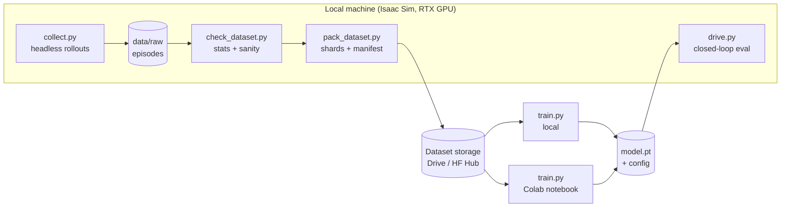

# 0006 Pipeline: automated data gathering → training (local or Colab)

Status: draft · Date: 2026-10-26

## Problem

Data is produced in Isaac Sim, which needs a local RTX GPU and its own
Python. Training only needs PyTorch and can run on the same machine or on
a hosted GPU (Google Colab, Kaggle). Closed-loop testing needs Isaac Sim
again. The pipeline should:

- run data gathering unattended and survive crashes
- let one dataset version be used on any machine, with the same results
- use the same training code locally and on Colab
- bring the trained model back into Isaac Sim for closed-loop tests

## Overview



## Code layout (planned)

| File | Runs in | Imports `omni`/`pxr`? | Role |
|---|---|---|---|
| `scene_gen.py` | Isaac Sim | yes | Build road, styles, obstacle pool; randomize layout |
| `collect.py` | Isaac Sim | yes | Data gatherer: roll out the expert, capture camera + lidar, write episodes |
| `sim_core/geometry.py`, `sim_core/expert.py` | anywhere | **no** | Point-mass model, collision checks, cost-to-go expert, distance targets. Pure NumPy. |
| `check_dataset.py` | anywhere | no | Statistics, class balance, lidar vs geometry check, image contact sheet |
| `pack_dataset.py` | anywhere | no | Pack episodes into shards, write `manifest.json` |
| `train/dataset.py`, `train/models.py`, `train.py` | local / Colab | no | PyTorch dataset, models (CNN, stack, CNN+GRU), training loop |
| `drive.py` | Isaac Sim | yes | Load exported model, drive closed loop, write metrics |
| `configs/*.yaml` | — | — | Generation and training configs |
| `notebooks/colab_train.ipynb` | Colab | no | Thin wrapper: mount storage, fetch data, call `train.py` |

The geometry and expert code must not import `omni`. Then it can be
unit-tested with normal Python, reused by `drive.py` for scoring, and used
to **relabel datasets offline** ([0005](0005-control-vector.md#proposal))
on any machine.

Two Python environments:
- `~/isaacsim/python.sh` for `collect.py` and `drive.py`
- a normal venv (or Colab) for the rest, with pinned `requirements-train.txt`

## Stage 1: Automated data gatherer (`collect.py`)

```bash
~/isaacsim/python.sh collect.py --config configs/gen_v1.yaml \
    --start 0 --count 500 --out data/raw/v1 --headless
```

- **Config-driven.** Road styles, obstacle ranges, step size, perturbation
  rate, resolution, sensors and seed live in a YAML file. The config is copied
  into the output folder.
- **Reproducible per episode.** Episode `i` uses seed `base_seed + i`, so any
  single episode can be regenerated and inspected in the GUI with
  `--start i --count 1` without `--headless`.
- **Resumable.** Each episode is written to `ep_XXXXXX.tmp/` and renamed when
  complete. On restart, finished episodes are skipped and `.tmp` leftovers
  are deleted. A crash after 6 hours loses at most one episode.
- **Shardable.** `--start/--count` lets several runs (or several nights)
  cover disjoint episode ranges. Running several Isaac Sim processes on one GPU
  is limited by VRAM; measure first.
- **Fast.** No `time.sleep`. Render only as many subframes as needed for a
  clean frame (`rt_subframes`, see [simulator.md](../knowledge/simulator.md#camera-capture-replicator-from-the-601-docs)).
  The RTX lidar needs the timeline playing and stepping with `app.update()`,
  so test camera + lidar capture together early. Lidar can be skipped or switched to
  the analytic scan for bulk data ([0003](0003-lidar-verification.md)).
- **Logs** per episode: steps, success, rejected layouts, time per step. A
  summary line every N episodes gives an ETA.
- **Provenance.** Write the git commit hash, Isaac Sim version and config
  hash into each `scene.json` and into the manifest.

## Stage 2: Check and pack

`check_dataset.py` (run before uploading anything):
- episode count, success rate, rejected-layout rate
- action distribution, overall and per road style
- distance target ranges
- lidar vs geometry agreement (catches frame/offset bugs)
- a contact sheet PNG of random frames with labels drawn on them, for a
  quick visual check

`pack_dataset.py`: thousands of small PNGs are slow on Google Drive and in
Colab, so the distributed format is **one compressed `.npz` per episode**:

```
dataset_v1/
  manifest.json          # version, generator commit, config, splits, per-file sha256
  train/ep_000000.npz    # images uint8 [T,H,W,3], actions, costs, states, distances, lidar
  train/ep_000001.npz
  val/...
  test/...
  test_ood/...           # held-out road styles
```

Size at 160×120: ~57 kB raw per frame. 40 k frames ≈ 2.3 GB uncompressed,
less as npz. That **fits in RAM** on a Colab instance, so the training loader
can load everything at start and avoid disk I/O entirely. If the dataset grows
beyond RAM, group episodes into larger shards (e.g. WebDataset `.tar`).

Splits are assigned at packing time by episode (seed range), never by frame.

## Stage 3: Storage and transfer

| Option | Pros | Cons |
|---|---|---|
| **Google Drive** (shared folder) | Free 15 GB per account, mounts directly in Colab | Slow with many files; mount reads are slow, so copy to `/content` first |
| **Hugging Face Hub** (private dataset repo) | Fast downloads in Colab, versioned, `huggingface_hub` one-liner | Needs an account/token; 1 GB+ files upload via LFS |
| Kaggle Datasets | Pairs with Kaggle's free GPU quota | Another platform to manage |

Recommendation: start with **Google Drive**, uploading zipped dataset versions
(`dataset_v1.zip`) with `rclone` or the web UI. In Colab, copy the zip to
`/content` and unzip it there. Move to HF Hub if Drive gets slow.

This is also what the official Colab FAQ advises. Drive has per-file and
per-user operation and bandwidth quotas, and "accessing too many distinct
files too quickly" gives I/O errors. Copy archives to the VM and unpack them
there instead of reading many small files from the mounted Drive.

Never commit datasets to git (`data/` is already ignored).

## Stage 4: Training (`train.py`, local or Colab)

Same command everywhere:

```bash
python train.py --config configs/train_cnn.yaml --data /path/to/dataset_v1 --out runs/cnn_001
```

- **No Isaac Sim dependency.** Only `torch`, `torchvision`, `numpy`, `pyyaml`
  (+ optional `tensorboard`/`wandb`).
- **Checkpoint every epoch** and resume with `--resume`. Required for Colab.
  The FAQ says VMs are deleted when idle and have a maximum lifetime, and
  that free-tier limits (idle timeout, lifetime, GPU type) are **not
  published and change over time**. Write checkpoints to Drive, not to
  `/content`, which is lost on disconnect.
- Colab can also connect to a **local runtime**: the notebook UI running on
  your own GPU. Drive mounting does not work in that mode.
- **Deterministic seeds**; log the dataset `manifest.json` version with every
  run, so results can be traced to the data.
- **Feature precomputation** ([0004](0004-sequence-training.md#training-details)):
  `train.py --precompute-features` runs the frozen encoder once and saves
  features. Sequence models then train in minutes even on a free GPU.
- Outputs per run: `config.yaml`, `metrics.csv`, `best.pt`, `last.pt`, and
  an exported **TorchScript** `model.ts` for `drive.py`.

Colab notebook (`notebooks/colab_train.ipynb`) only does:
1. `git clone` the repo (public, or with a token)
2. `pip install -r requirements-train.txt` (keep Colab's preinstalled torch)
3. mount Drive, copy and unzip the dataset to `/content`
4. `!python train.py ... --out /content/drive/MyDrive/project_ai/runs/...`

All logic stays in `train.py`, so local and Colab runs can't drift apart.

**Smoke test (exists):** [`notebooks/colab_smoke_test.ipynb`](../../notebooks/colab_smoke_test.ipynb)
checks this stage before any real data exists. It covers GPU, Drive mount, repo
clone, a synthetic dataset in the per-episode `.npz` format, the zip → Drive →
unzip round trip, ResNet18 fine-tuning, checkpoint + resume from Drive, and
TorchScript export. Open it in Colab and choose *Run all*. The last cell
prints PASS/FAIL per check. Its training code is self-contained and is not
yet the real `train.py`.

Local training: the Isaac Sim machine already has an RTX GPU. Don't run
`collect.py` and training at the same time unless VRAM allows.

## Stage 5: Closed-loop evaluation (`drive.py`, local only)

Colab cannot run Isaac Sim, so closed-loop tests run locally:

```bash
~/isaacsim/python.sh drive.py --model runs/cnn_001/model.ts --config configs/gen_v1.yaml \
    --start 100000 --count 200 --headless
```

- Uses seed ranges not used in any dataset, plus the held-out styles.
- Reuses `sim_core` for collision checks and distance metrics.
- Writes `eval.json` (success, collisions, min clearance, steps) next to
  the run, plus optional videos of a few episodes.
- DAgger ([0002](0002-dataset-generation.md#perturbations-against-covariate-shift)):
  `drive.py --record` saves the visited states and images in the same
  episode format. The expert labels them, and they are packed as an extra
  dataset part.

To check: whether Isaac Sim's bundled Python has `torch`. If it doesn't,
install it into Isaac's Python or load the exported model with ONNX Runtime.

## Alternatives

- **Train inside Isaac Sim's Python.** One environment, but heavy, slow to
  start and impossible on Colab. Rejected.
- **Stream data from the simulator straight into training** (online
  generation). Interesting for DAgger/RL later, but it ties training to the
  local machine. Offline datasets first.
- **PNG folders as the distributed format.** Easy to look at, but slow on
  Drive and Colab. Keep PNG output as a debug option (`--save-png`).

## Open questions

- Q11–Q13 in [open-questions.md](../open-questions.md).
